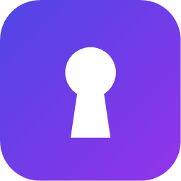
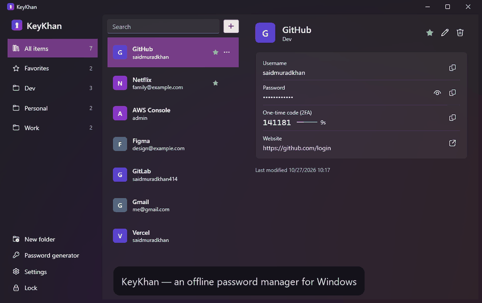

<div align="center">
  
  <h1>KeyKhan</h1>
  <p>
    <b>A fast, offline password manager for Windows.</b><br>
    Press <kbd>Win</kbd> + <kbd>~</kbd> anywhere, type a few letters, hit <kbd>Enter</kbd> — the password is on your clipboard.
  </p>
  <p>
    <a href="https://github.com/saidmuradkhan/KeyKhan/actions/workflows/ci.yml"></a>
    <a href="https://github.com/saidmuradkhan/KeyKhan/releases/latest"></a>
    <a href="https://github.com/saidmuradkhan/KeyKhan/releases"></a>
    
    <a href="LICENSE"></a>
  </p>
  <p>
    <a href="https://github.com/saidmuradkhan/KeyKhan/releases/latest/download/KeyKhan-Setup.exe"><b>⬇ Download for Windows</b></a>
    &nbsp;·&nbsp; <a href="#features">Features</a>
    &nbsp;·&nbsp; <a href="#security-design">Security</a>
    &nbsp;·&nbsp; <a href="CONTRIBUTING.md">Contributing</a>
  </p>
  
</div>

## Why KeyKhan?

- **Built for the keyboard.** One global shortcut, a few letters, <kbd>Enter</kbd>. It can even auto-type the login into the app you were using.
- **Yours, on your PC.** No account, no cloud, no subscription. The vault is a single encrypted file you can back up or sync however you like.
- **Serious crypto, done by the OS.** AES-256-GCM and PBKDF2 from Windows CNG, called from a small C++ core that keeps keys out of the .NET heap.
- **Native Windows 11 feel.** Fluent design, light and dark theme, tray icon, starts with Windows.

| | KeyKhan | Typical cloud password manager |
| --- | --- | --- |
| Account required | No | Yes |
| Your vault leaves your PC | Never | Synced to the provider |
| Price | Free, MIT licensed | Often a subscription |
| Works offline | Always | Depends |

*KeyKhan* = **Key** + **Khan**, after its author Said Muradkhan.


## Features

- **Quick access from anywhere** — a global shortcut (default `Win + ~`) opens a Spotlight-style search over your vault. Any combination works, including `Win` + any key that Windows normally keeps for itself (only `Win + L` is off limits).
  - `Enter` copy password · `Shift+Enter` copy username · `Ctrl+Enter` auto-type username, Tab, password, Enter into the app you were using · `Ctrl+T` copy 2FA code · `PgUp`/`PgDn` previous/next · `Ctrl+O` open website · `Esc` close
- **Every shortcut is yours** — change any of them in **Settings → Keyboard shortcuts**.
- **Safe clipboard** — copied secrets are excluded from Windows clipboard history and cloud clipboard, and are cleared after 20 seconds (configurable).
- **Built-in authenticator** — store a 2FA setup key or `otpauth://` link and KeyKhan shows the current one-time code (TOTP, SHA-1/256/512).
- **Password generator** — length, character sets, look-alike exclusion, strength meter.
- **Folders** for projects, clients or anything else — create, rename and delete them in the sidebar, then drag an entry onto a folder (or onto Favorites), or use its **⋯** menu → **Add to folder**. Plus favorites, instant search and letter avatars.
- **Recovery key** — forgot the master password? The recovery key you saved when creating the vault lets you set a new one.
- **Remember me on this computer** (optional) — skip the master password and unlock with your Windows sign-in. While it is on, Lock takes you to this setting, since the vault would unlock itself again.
- **Auto-lock** after inactivity, when Windows locks and before sleep.
- **Import** CSV exports from Chrome, Edge, Firefox, Bitwarden, LastPass, 1Password and KeePass; **export** to CSV.
- **Tray app** — starts with Windows (optional), lives in the notification area.
- **Automatic updates** — KeyKhan tells you when a new version is out and installs it in one click.
- Light, dark or system theme.

<p>
  
  
</p>

## Install

Download **[KeyKhan-Setup.exe](https://github.com/saidmuradkhan/KeyKhan/releases/latest/download/KeyKhan-Setup.exe)** and run it. No administrator rights and no .NET installation are needed; KeyKhan is added to the Start menu and starts with Windows (you can untick that).

On first start KeyKhan asks you to create a master password and shows your **recovery key** — save it somewhere safe.

> Windows SmartScreen may warn about an unsigned app the first time; click **More info → Run anyway**.
>
> Prefer a portable app? Download [KeyKhan.exe](https://github.com/saidmuradkhan/KeyKhan/releases/latest/download/KeyKhan.exe) and run it from anywhere.

Uninstall from **Settings → Apps → Installed apps**. Your vault in `%APPDATA%\KeyKhan` is kept.

### Updates

KeyKhan checks GitHub for a new release when you open it and every few hours. When one is out, a bar at the top of the window offers **Install and restart**: the installer is downloaded, checked against the SHA-256 digest GitHub publishes for it, installed silently and KeyKhan reopens. The portable `KeyKhan.exe` opens the download page instead. Turn the check off, or run it by hand, in **Settings → Updates**.

Coming from KeyKhan 1.0? Your vault is upgraded to the new format the first time you unlock it — the original is kept as `vault.keykhan.v1.bak` — and you get a recovery key to save.

## Keyboard shortcuts

The defaults are below; all of them can be changed in **Settings → Keyboard shortcuts** (click a box and press the new combination).

| Main window | | Quick access | |
| --- | --- | --- | --- |
| `Ctrl+F` | Search | `Enter` | Copy password |
| `Ctrl+N` | New entry | `Shift+Enter` | Copy username |
| `Ctrl+E` | Edit entry | `Ctrl+Enter` | Auto-type login |
| `Del` | Delete entry | `Ctrl+T` | Copy 2FA code |
| `Ctrl+C` | Copy password | `Ctrl+O` | Open website |
| `Ctrl+B` | Copy username | `PgDn` / `↓` | Next result |
| `Ctrl+T` | Copy 2FA code | `PgUp` / `↑` | Previous result |
| `Ctrl+U` | Open website | `Esc` | Close |
| `Ctrl+D` | Toggle favorite | | |
| `Ctrl+G` | Password generator | | |
| `Ctrl+L` | Lock | | |

Why can KeyKhan use `Win + K` and friends? Windows reserves nearly every `Win` combination, so the normal hotkey API refuses them. When that happens KeyKhan watches for the combination with a low-level keyboard hook, which only looks for that one combination and only exists while such a hotkey is set.

## Build from source

Requirements (Windows 10/11 x64):

- [.NET 10 SDK](https://dotnet.microsoft.com/download) — `winget install Microsoft.DotNet.SDK.10`
- Visual Studio 2022/2026 **or** Build Tools with the **Desktop development with C++** workload —
  `winget install Microsoft.VisualStudio.2022.BuildTools --override "--add Microsoft.VisualStudio.Workload.VCTools --includeRecommended --passive"`
- [Inno Setup 6](https://jrsoftware.org/isinfo.php), only for the installer — `winget install JRSoftware.InnoSetup`

```powershell
git clone https://github.com/saidmuradkhan/KeyKhan.git
cd KeyKhan
.\build.ps1              # runs the tests, produces artifacts\publish\KeyKhan.exe
.\build.ps1 -Installer   # also produces artifacts\installer\KeyKhan-Setup.exe
```

For development, open `KeyKhan.sln` in Visual Studio, or:

```powershell
dotnet run --project src/KeyKhan.App
dotnet test --project installer/           Inno Setup script for KeyKhan-Setup.exe
tests/KeyKhan.Vault.Tests
```

`dotnet build` compiles the C++ core automatically by locating Visual Studio's MSBuild with `vswhere`.

## Security design

| | |
| --- | --- |
| Keys | Entries are encrypted with a random 256-bit data key. That key is stored twice, wrapped (AES-256-GCM) under a key derived from the master password and under one derived from the recovery key |
| Key derivation | PBKDF2-HMAC-SHA256 with a 256-bit random salt: 600 000 iterations for the master password, 10 000 for the 160-bit random recovery key |
| Encryption | AES-256-GCM; a fresh random nonce on every save |
| Integrity | The file header (format version, key slots, salts) is authenticated as GCM associated data, so it cannot be tampered with |
| Key custody | Keys never leave the C++ core. It lives in memory locked against paging (`VirtualLock`) and is wiped with `SecureZeroMemory` on lock |
| Master password | Read from WPF's `PasswordBox` as a `SecureString` and handed to the core through unmanaged memory that is zeroed immediately — it never becomes a .NET string |
| Storage | Writes go to a temporary file and atomically replace the vault, so a crash or power loss cannot corrupt it |
| Remember me | Optional. The data key is encrypted with Windows DPAPI for your account and stored in `%LOCALAPPDATA%\KeyKhan\device.key`; it is useless on another computer or account |
| Clipboard | Marked `ExcludeClipboardContentFromMonitorProcessing`, `CanIncludeInClipboardHistory = 0`, `CanUploadToCloudClipboard = 0`; cleared after a timeout |

All cryptography comes from the operating system (Windows CNG / `bcrypt.dll`); there is no custom cipher code. The only network request KeyKhan makes is the update check described above, which sends nothing about you or your vault.

**Limitations.** While the vault is unlocked, entries are held in the app's memory as ordinary .NET strings, which the garbage collector may copy and cannot reliably wipe — locking the vault releases them. Anyone with administrator access to your running, unlocked session can read your vault; no password manager can prevent that. Without both the master password and the recovery key the vault cannot be opened — by design, nobody can recover it for you.

### Vault file and sync

The vault is a single file: `%APPDATA%\KeyKhan\vault.keykhan`. Back it up like any other file. To keep it in a synced folder (OneDrive, Dropbox, …), close KeyKhan and edit `VaultPath` in `%APPDATA%\KeyKhan\settings.json`, then move the file there. Setting the `KEYKHAN_HOME` environment variable keeps all of KeyKhan's files in that folder instead — handy for a second profile or for development.

File format (little-endian):

```
"KKVT" | u16 version | u8 slot count
  slot × N: u8 kind (1 password, 2 recovery key) | u32 iterations | u8 salt length | salt | wrapped data key(60)
nonce(12) | ciphertext | tag(16)
```

The ciphertext is UTF-8 JSON holding the entries and the folder list.

## Project structure

```
src/
  KeyKhan.Native/   C++20 core: PBKDF2, AES-GCM, key wrapping, DPAPI, TOTP and key custody over Windows CNG (C ABI)
  KeyKhan.Vault/    .NET library: file format, vault, generator, search, CSV import/export
  KeyKhan.App/      WPF application: MVVM views, global hotkey, tray, clipboard, auto-lock, auto-type
installer/           Inno Setup script for KeyKhan-Setup.exe
tests/
  KeyKhan.Vault.Tests/   xUnit tests, including RFC 6238 TOTP vectors, tamper detection and 1.0 upgrades
  KeyKhan.App.Tests/     shortcut validation and update parsing
```

## License

[MIT](LICENSE)
