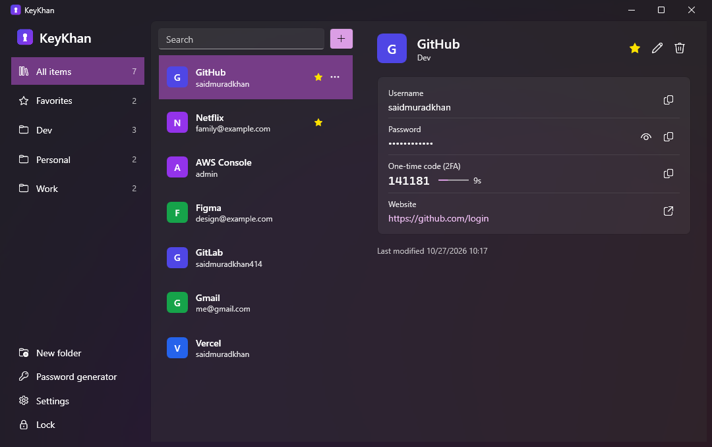
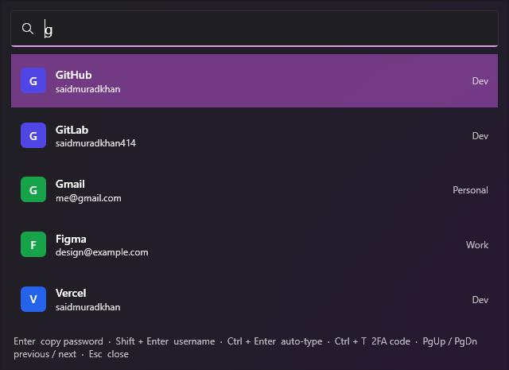
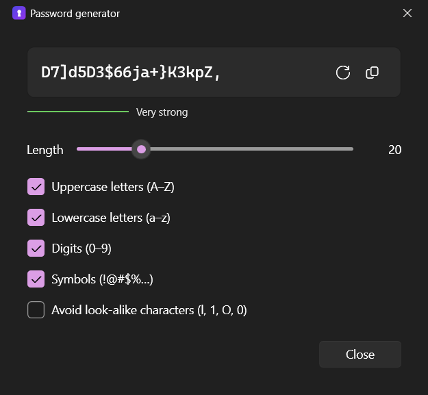

# KeyKhan

A fast, offline password manager for Windows. Press **Win + ~** anywhere, type a few letters, hit **Enter** — the password is on your clipboard and the window is gone.

The cryptographic core is written in **C++** on top of Windows CNG; the app is **.NET 10 / WPF** with the Windows 11 Fluent theme.

*KeyKhan* = **Key** + **Khan**, after its author Said Muradkhan.



## Features

- **Quick access from anywhere** — a global shortcut (default `Win + ~`, configurable) opens a Spotlight-style search over your vault.
  - `Enter` copy password · `Shift+Enter` copy username · `Ctrl+Enter` auto-type username, Tab, password, Enter into the app you were using · `Ctrl+T` copy 2FA code · `Ctrl+O` open website · `Esc` close
- **Safe clipboard** — copied secrets are excluded from Windows clipboard history and cloud clipboard, and are cleared after 20 seconds (configurable).
- **Built-in authenticator** — store a 2FA setup key or `otpauth://` link and KeyKhan shows the current one-time code (TOTP, SHA-1/256/512).
- **Password generator** — length, character sets, look-alike exclusion, strength meter.
- **Folders and favorites**, instant search, letter avatars.
- **Recovery key** — forgot the master password? The recovery key you saved when creating the vault lets you set a new one.
- **Remember me on this computer** (optional) — skip the master password and unlock with your Windows sign-in.
- **Auto-lock** after inactivity, when Windows locks and before sleep.
- **Import** CSV exports from Chrome, Edge, Firefox, Bitwarden, LastPass, 1Password and KeePass; **export** to CSV.
- **Tray app** — starts with Windows (optional), lives in the notification area.
- Light, dark or system theme.

<p>
  
  
</p>

## Install

Download **[KeyKhan-Setup.exe](https://github.com/saidmuradkhan/KeyKhan/releases/latest/download/KeyKhan-Setup.exe)** and run it. No administrator rights and no .NET installation are needed; KeyKhan is added to the Start menu and starts with Windows (you can untick that).

On first start KeyKhan asks you to create a master password and shows your **recovery key** — save it somewhere safe.

> Windows SmartScreen may warn about an unsigned app the first time; click **More info → Run anyway**.
>
> Prefer a portable app? Download [KeyKhan.exe](https://github.com/saidmuradkhan/KeyKhan/releases/latest/download/KeyKhan.exe) and run it from anywhere.

Uninstall from **Settings → Apps → Installed apps**. Your vault in `%APPDATA%\KeyKhan` is kept.

## Keyboard shortcuts

| Main window | |
| --- | --- |
| `Ctrl+F` | Search |
| `Ctrl+N` | New entry |
| `Ctrl+E` / double-click | Edit entry |
| `Ctrl+C` / `Enter` in search | Copy password |
| `Ctrl+B` | Copy username |
| `Ctrl+T` | Copy 2FA code |
| `Ctrl+U` | Open website |
| `Ctrl+D` | Toggle favorite |
| `Ctrl+G` | Password generator |
| `Ctrl+L` | Lock |
| `Del` | Delete entry |

Change the global shortcut in **Settings → Quick access**: click the box and press the new combination.

## Build from source

Requirements (Windows 10/11 x64):

- [.NET 10 SDK](https://dotnet.microsoft.com/download) — `winget install Microsoft.DotNet.SDK.10`
- Visual Studio 2022/2026 **or** Build Tools with the **Desktop development with C++** workload —
  `winget install Microsoft.VisualStudio.2022.BuildTools --override "--add Microsoft.VisualStudio.Workload.VCTools --includeRecommended --passive"`
- [Inno Setup 6](https://jrsoftware.org/isinfo.php), only for the installer — `winget install JRSoftware.InnoSetup`

```powershell
git clone https://github.com/saidmuradkhan/KeyKhan.git
cd KeyKhan
.\build.ps1              # runs the tests, produces artifacts\publish\KeyKhan.exe
.\build.ps1 -Installer   # also produces artifacts\installer\KeyKhan-Setup.exe
```

For development, open `KeyKhan.sln` in Visual Studio, or:

```powershell
dotnet run --project src/KeyKhan.App
dotnet test --project installer/           Inno Setup script for KeyKhan-Setup.exe
tests/KeyKhan.Vault.Tests
```

`dotnet build` compiles the C++ core automatically by locating Visual Studio's MSBuild with `vswhere`.

## Security design

| | |
| --- | --- |
| Keys | Entries are encrypted with a random 256-bit data key. That key is stored twice, wrapped (AES-256-GCM) under a key derived from the master password and under one derived from the recovery key |
| Key derivation | PBKDF2-HMAC-SHA256 with a 256-bit random salt: 600 000 iterations for the master password, 10 000 for the 160-bit random recovery key |
| Encryption | AES-256-GCM; a fresh random nonce on every save |
| Integrity | The file header (format version, key slots, salts) is authenticated as GCM associated data, so it cannot be tampered with |
| Key custody | Keys never leave the C++ core. It lives in memory locked against paging (`VirtualLock`) and is wiped with `SecureZeroMemory` on lock |
| Master password | Read from WPF's `PasswordBox` as a `SecureString` and handed to the core through unmanaged memory that is zeroed immediately — it never becomes a .NET string |
| Storage | Writes go to a temporary file and atomically replace the vault, so a crash or power loss cannot corrupt it |
| Remember me | Optional. The data key is encrypted with Windows DPAPI for your account and stored in `%LOCALAPPDATA%\KeyKhan\device.key`; it is useless on another computer or account |
| Clipboard | Marked `ExcludeClipboardContentFromMonitorProcessing`, `CanIncludeInClipboardHistory = 0`, `CanUploadToCloudClipboard = 0`; cleared after a timeout |

All cryptography comes from the operating system (Windows CNG / `bcrypt.dll`); there is no custom cipher code. KeyKhan never talks to the network.

**Limitations.** While the vault is unlocked, entries are held in the app's memory as ordinary .NET strings, which the garbage collector may copy and cannot reliably wipe — locking the vault releases them. Anyone with administrator access to your running, unlocked session can read your vault; no password manager can prevent that. Without both the master password and the recovery key the vault cannot be opened — by design, nobody can recover it for you.

### Vault file and sync

The vault is a single file: `%APPDATA%\KeyKhan\vault.keykhan`. Back it up like any other file. To keep it in a synced folder (OneDrive, Dropbox, …), close KeyKhan and edit `VaultPath` in `%APPDATA%\KeyKhan\settings.json`, then move the file there.

File format (little-endian):

```
"KKVT" | u16 version | u8 slot count
  slot × N: u8 kind (1 password, 2 recovery key) | u32 iterations | u8 salt length | salt | wrapped data key(60)
nonce(12) | ciphertext | tag(16)
```

The ciphertext is the UTF-8 JSON list of entries.

## Project structure

```
src/
  KeyKhan.Native/   C++20 core: PBKDF2, AES-GCM, key wrapping, DPAPI, TOTP and key custody over Windows CNG (C ABI)
  KeyKhan.Vault/    .NET library: file format, vault, generator, search, CSV import/export
  KeyKhan.App/      WPF application: MVVM views, global hotkey, tray, clipboard, auto-lock, auto-type
installer/           Inno Setup script for KeyKhan-Setup.exe
tests/
  KeyKhan.Vault.Tests/   xUnit tests, including RFC 6238 TOTP vectors and tamper detection
```

## License

[MIT](LICENSE)
